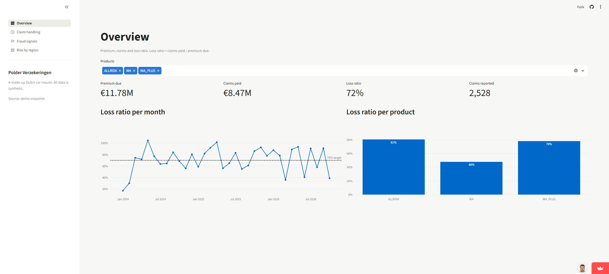
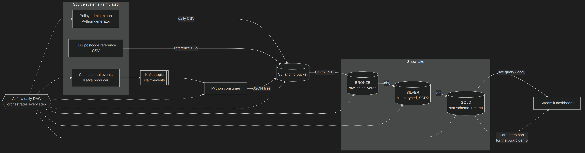
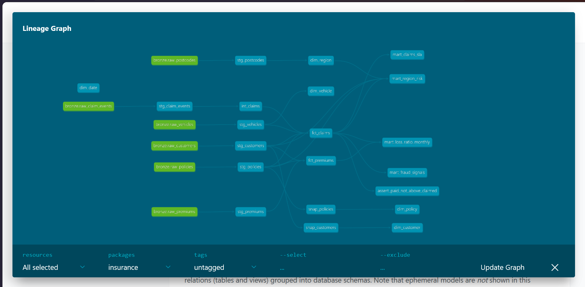
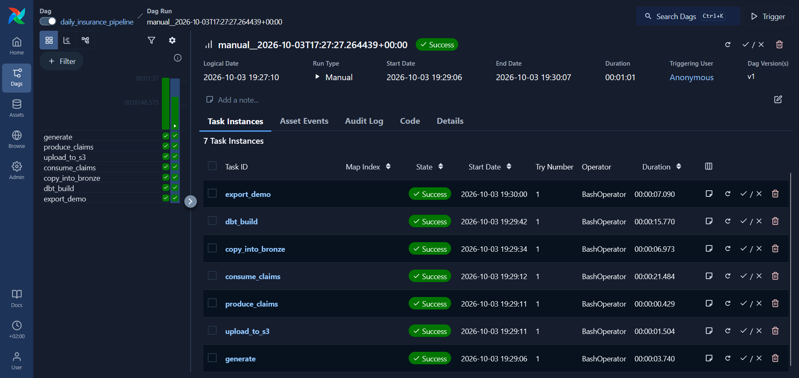
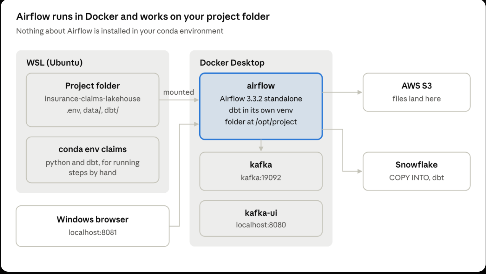

# Insurance Claims Lakehouse


A data platform for **Polder Verzekeringen**, a made-up Dutch car insurer.
Daily policy extracts and real-time claim events land in Snowflake, dbt
models them into Bronze / Silver / Gold layers, and a Streamlit dashboard
answers the questions management actually asks: are we making money on
each product, how fast do we pay claims, and which claims look suspicious?

**Live demo:** https://polder-insurance.streamlit.app



Stack: Python · Kafka · AWS S3 · Snowflake · dbt · Airflow · Docker · Streamlit · GitHub Actions

## Architecture



Everything goes through S3 first and only then into Snowflake. That way
Bronze always has a file I can point at when a number looks wrong.

- **Batch path:** a Python generator plays the policy admin system and
  writes daily CSV extracts. They go to S3 and are loaded into Bronze with
  `COPY INTO` through a storage integration (IAM role, no access keys).
  The CBS postcode reference takes the same route.
- **Streaming path:** claim events (reported, assessed, approved/rejected,
  paid) go through a Kafka topic. A consumer batches them into small JSON
  files in S3, which land in a `VARIANT` column in Bronze.
- **Serving:** the dashboard reads Gold live when it runs on my laptop. The
  public demo reads a Parquet export of Gold instead (more on that below).

More detail and the layer rules are in [docs/architecture.md](docs/architecture.md).

## Modelling with dbt

dbt builds Silver (typed, cleaned, deduplicated, plus SCD2 snapshots of
customers and policies) and Gold (a small star schema and four marts).
The green nodes on the left are the raw Bronze tables. Everything to the
right of them is a dbt model, snapshot or test.



### What's in Gold

| Table                                   | Grain                                     | Used for                                       |
| --------------------------------------- | ----------------------------------------- | ---------------------------------------------- |
| `fct_claims`                            | one claim                                 | everything about claims                        |
| `fct_premiums`                          | one monthly instalment                    | premium income                                 |
| `dim_customer`, `dim_policy`            | one version of a customer / policy (SCD2) | history, e.g. premium before and after renewal |
| `dim_vehicle`, `dim_region`, `dim_date` | one car / postcode / day                  | slicing                                        |
| `mart_loss_ratio_monthly`               | month × product                           | loss ratio trend                               |
| `mart_claims_sla`                       | month × claim type                        | handling speed                                 |
| `mart_fraud_signals`                    | one flagged claim                         | review list                                    |
| `mart_region_risk`                      | municipality                              | claims per 1,000 policies                      |

## Orchestration with Airflow

One DAG runs a whole business day: generate the extracts and events,
upload to S3, push the events through Kafka, load Bronze, run `dbt build`
and refresh the dashboard's Parquet export. Upload and the Kafka path run
side by side; the load only starts when both are done.



Airflow, Kafka and Kafka UI all run in Docker Compose on my laptop, so the
whole stack comes up with one command and goes away with another.



## Things I ran into

- **Messy source data, on purpose.** The generator exports the kind of mess
  a real policy system produces: postcodes like `3821ab`, emails in capitals,
  phone numbers written as `+31 6 ...` or `06...`, and the same customer sent
  twice. I kept Bronze exactly as it arrives (all `VARCHAR`, plus the source
  file and load time) and did the cleaning in the dbt Silver models:
  `row_number()` keeps the latest version of each record, `try_to_date`
  turns bad dates into NULL instead of failing the load, and a few
  `regexp_replace` rules bring postcodes and phone numbers into one format.
  The rules live in `dbt/models/silver/`, and dbt tests (`unique`,
  `not_null`, `relationships`, `accepted_values` and one custom test)
  check the result on every build.
- **A wrong file format looked like a data problem.** On the first load the
  `not_null` test on postcode failed for every customer. The data was fine;
  the Snowflake file format split on commas while the extracts use
  semicolons, so every column after the first was shifted. Fixing
  `FF_CSV_SEMICOLON` and reloading solved it, and it is the reason I trust
  tests on Silver more than eyeballing a few rows.
- **Kafka delivers at least once.** If the consumer crashes after writing a
  batch to S3 but before committing its offset, the same events arrive
  again. Instead of trying to make the consumer perfect, I made the model
  idempotent: `stg_claim_events` is an incremental dbt model that only reads
  new Bronze rows and keeps the first copy of each `event_id`
  (`qualify row_number() ... = 1`).
- **SCD2 history only starts when the snapshots start.** The backfill is a
  picture of one day, so `dim_customer` and `dim_policy` begin with a single
  version per record. dbt snapshots (timestamp strategy on `updated_at`)
  add a new version for every house move or renewal from then on. Two
  details cost me time here. The snapshot compares timestamps, so
  `updated_at` has to be cast to `timestamp_ntz` in Silver, not left as a
  date. And for a while the customer column was called `update_at`, one
  letter short. Nothing broke, because the snapshot config had the same
  typo. I only spotted it when reviewing the repo. Renaming the column in
  the existing snapshot table kept the history instead of starting over.
- **Two calendars that disagreed.** My first Airflow DAG passed Airflow's
  run date to the generator, but the generator keeps its own calendar and
  refuses to skip a day. After a few days made by hand, the two were out of
  step and the DAG failed on its first task. Now every task reads the last
  business day from the generator's state file, so one DAG run simply means
  "one more day", whenever it runs. `catchup` is off and
  `max_active_runs=1`, so two runs never touch the state at the same time.
- **The fraud rules found what I hid.** The generator plants a small set of
  large claims shortly after a policy starts. Four plain SQL rules in
  `mart_fraud_signals` (early claim, late report, claim close to the car's
  value, three or more claims in a year) flag almost all of them, among 210
  flagged claims in total. It is a review list, not a verdict, and the
  dashboard shows how many of those claims are still open and can be
  stopped.
- **The demo outlives the Snowflake trial.** The dashboard reads Gold live
  from Snowflake when credentials are in `.env`. Without them it falls back
  to a small Parquet export in `dashboard/demo_data/`, which Airflow
  refreshes after every run. The public app runs in that mode, so no
  password ever leaves my laptop.

## Run it yourself

You need Python 3.11, Docker Desktop, a Snowflake trial and an AWS account.

```bash
pip install -r requirements.txt
cp .env.example .env                         # fill in Snowflake + AWS

python scripts/build_postcode_reference.py   # once
python -m generator backfill                 # history up to 2026-09-30
pytest -q

# Snowflake: run snowflake/01, 02 and 03 in a worksheet (see comments inside)
python -m pipeline.s3_upload
python -m pipeline.bronze_load

cd dbt && dbt build --profiles-dir . && cd ..   # models, snapshots and tests

docker compose up -d                         # Kafka, Kafka UI (8080), Airflow (8081)
streamlit run dashboard/app.py
```

After that, open Airflow on http://localhost:8081 and trigger the DAG to
add one more business day.

## Repository layout

| Path         | What                                                         |
| ------------ | ------------------------------------------------------------ |
| `generator/` | synthetic source systems (policies, premiums, claim events)  |
| `scripts/`   | one-off helpers (postcode reference from CBS)                |
| `pipeline/`  | S3 upload, Bronze load, demo export                          |
| `streaming/` | Kafka producer and consumer                                  |
| `snowflake/` | setup SQL: warehouse, schemas, S3 integration, Bronze tables |
| `aws/`       | IAM policy and trust policy for the integration              |
| `dbt/`       | Silver and Gold models, snapshots, tests                     |
| `airflow/`   | DAG and the Airflow image                                    |
| `dashboard/` | Streamlit app and its demo data                              |
| `tests/`     | pytest for the generator and the consumer                    |

The postcode reference comes from my
[nl-housing-data-cleaning](https://github.com/alibaghdadi1368/nl-housing-data-cleaning)
project (CBS open data, CC-BY 4.0). All policy, customer and claim data is
synthetic.

## License

MIT, see [LICENSE](LICENSE).

## Contact

Ali Baghdadi · [LinkedIn](https://linkedin.com/in/alibaghdadi) · alibaghdadi1368@gmail.com